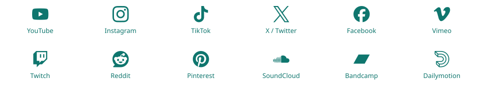
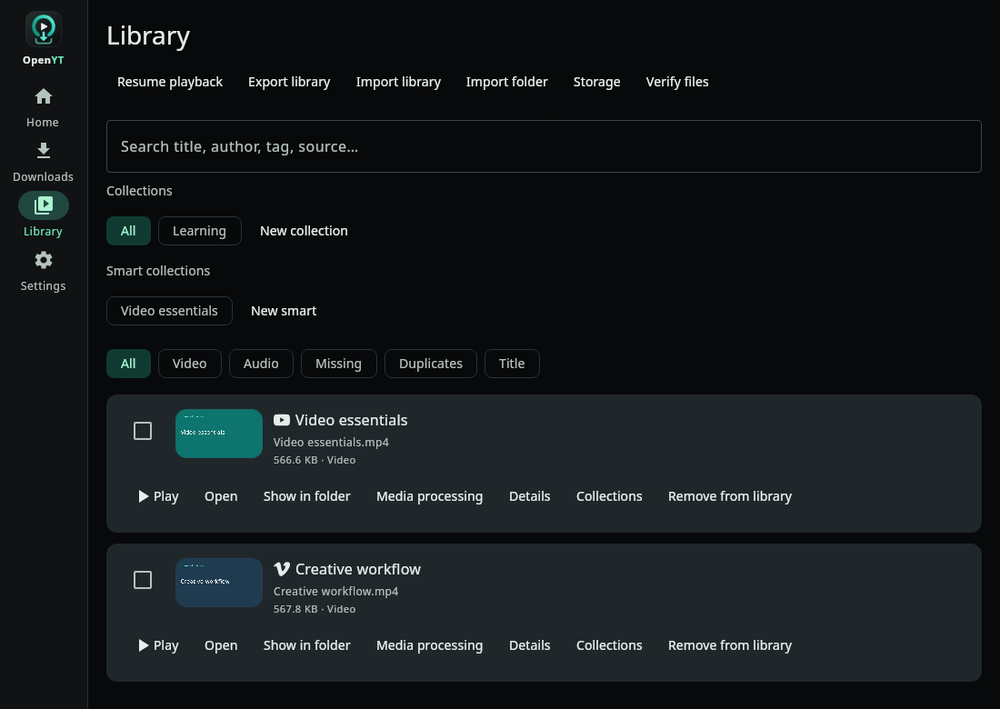
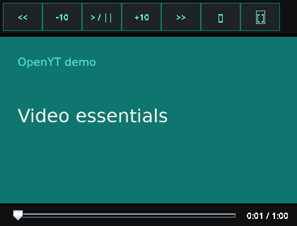
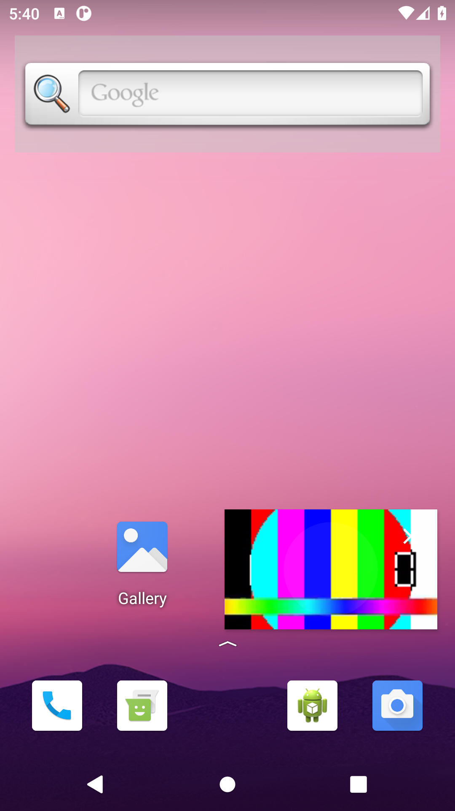
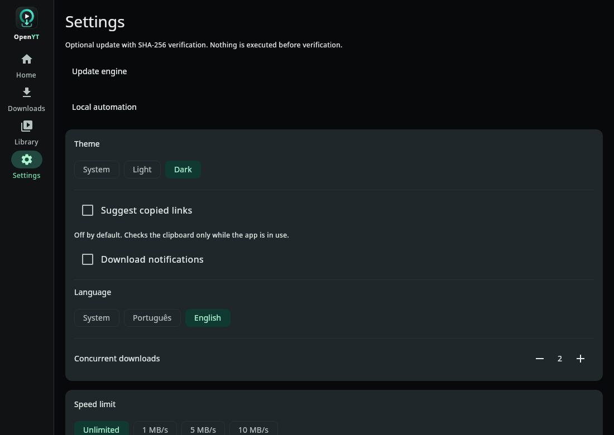
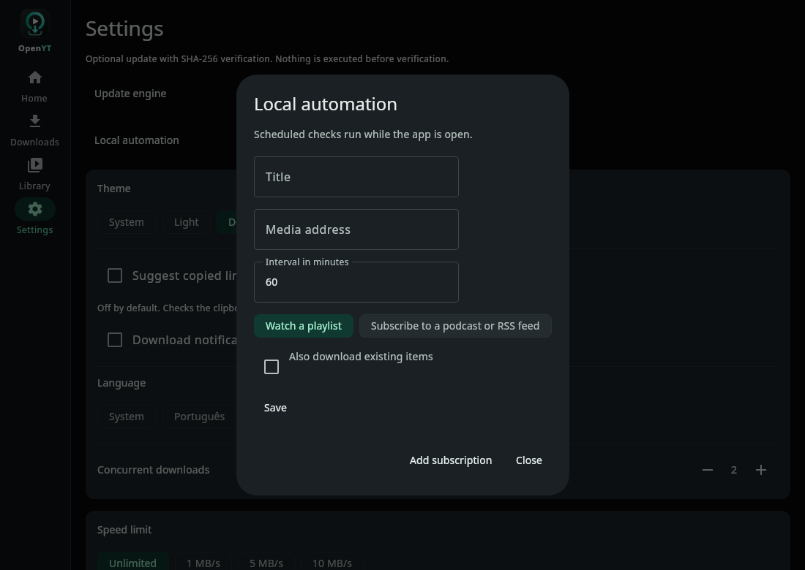
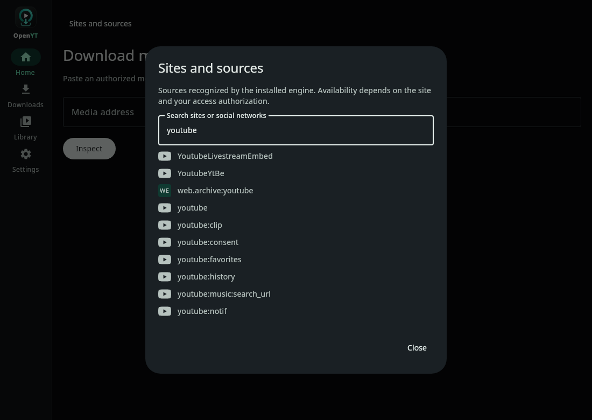
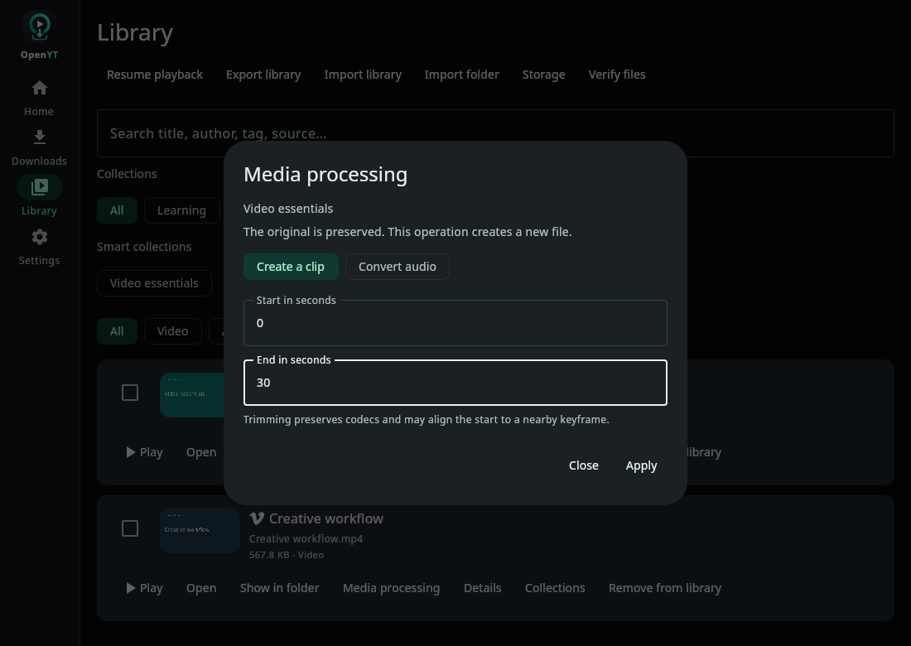

<picture>
  <source media="(prefers-color-scheme: dark)" srcset="docs/branding/openyt-lockup-dark.svg">
  
</picture>

# OpenYT — video downloader, audio downloader and media library

[](https://github.com/AlexandreZanata/OpenYT/releases/latest)
[](https://github.com/AlexandreZanata/OpenYT/actions/workflows/ci.yml)
[](LICENSE)
[](#download-and-install)

**Download videos, audio and playlists, organize your files, and keep watching
with Android picture-in-picture or a floating desktop mini-player.**

OpenYT is a local-first application built with **Kotlin Multiplatform**, **Compose
Multiplatform**, **yt-dlp** and **FFmpeg**. Downloads, library records and settings
stay on your device. There is no OpenYT account or remote download server.

[Download](https://github.com/AlexandreZanata/OpenYT/releases/latest) ·
[All supported sources](docs/SUPPORTED_SOURCES.md) ·
[Usage guide](docs/USAGE.md) · [What's new in 4.0](docs/releases/v4.0.0.md) ·
[Brand guidelines](docs/branding/README.md)

## Features

- **Video, audio and playlists:** inspect a link, review metadata and thumbnails,
  choose the available format, select playlist/channel/album entries, and choose
  formats per item. Files can be numbered and grouped into playlist folders.
- **Download queue:** priorities, 1–4 concurrent downloads, pause/resume with
  partial files preserved, cancellation, manual retry, automatic retry with
  backoff, speed limits and download time windows. Recover interrupted work
  after restarting the app.
- **Local media library:** search titles, authors, tags and sources; filter video,
  audio, missing files and possible duplicates; sort by title; create collections
  and smart collections; edit metadata and inspect technical media details.
- **File organization:** naming templates and organization presets, bulk
  rename/move with a preview, folder scanning/import, JSON library export/import,
  file verification, duplicate review and a storage report with import recovery.
  Removing a library record preserves the media file.
- **Playback:** a shared queue, saved playback positions, resume after restart,
  previous/next and ten-second seeking. Android adds background audio and system
  **PiP**; desktop adds a floating mini-player and keyboard controls.
- **Audio tools:** M4A, MP3, Opus, FLAC and WAV presets, optional loudness
  normalization and local audio conversion through FFmpeg.
- **Video tools:** reported manual/automatic subtitle tracks as sidecars or
  embedded captions, chapter preservation, optional SponsorBlock chapter marks,
  segment selection/preview and bounded live-stream capture.
- **Local editing:** create a clip or audio conversion from Library without
  replacing the original file. Lossless cuts can align to nearby keyframes.
- **Local automation:** subscribe to RSS/Atom feeds or watch playlists, record an
  initial baseline, choose whether to include existing entries, and avoid repeated
  downloads. Scheduled checks run while OpenYT is open.
- **Link intake and sharing:** paste, Android share intake, desktop dropped links,
  validated `openyt://` links, an optional active-tab browser extension and a
  desktop CLI. Share completed Android media through the OS chooser; open or
  reveal desktop files with the system's applications.
- **Language and appearance:** automatically follow the OS language, with
  Brazilian Portuguese and English overrides; system/light/dark themes; shared
  OpenYT branding; source logos and accessible fallback tiles; responsive phone,
  tablet and desktop layouts.
- **Optional conveniences:** foreground-only clipboard suggestions and download
  notifications, both off by default; authorized local cookies encrypted at rest.
- **Updates and diagnostics:** a searchable installed-source catalog, explicitly
  requested checksum-verified yt-dlp updates, redacted diagnostics and application
  installer verification against a pinned signed release manifest.

Embedded desktop playback, resume and the mini-player require **VLC/libvlc**.
Without it, files open in the OS player. Live capture defaults to 60 seconds and
can be bounded from 1 second to 24 hours. Generic photo/image gallery downloading
is outside this release ([ADR-0023](docs/adr/0023-engine-and-image-viability.md)).

## Supported sites and download sources

<picture>
  <source media="(prefers-color-scheme: dark)" srcset="docs/assets/v4/source-examples-dark.svg">
  
</picture>

The installed yt-dlp engine supplies the source catalog. Examples include:

- **Social video:** YouTube, Instagram, TikTok, X/Twitter, Facebook, Reddit,
  Pinterest, Bluesky, Tumblr and VK.
- **Video and live streams:** Vimeo, Twitch, Dailymotion, Rumble, Bilibili,
  PeerTube, Kick, Niconico and Internet Archive.
- **Music and audio:** SoundCloud, Bandcamp, Mixcloud, Audius and supported
  podcast feeds.
- **Learning and broadcasts:** TED, Khan Academy, LinkedIn Learning, Udemy,
  BBC and ARTE, subject to the source's access requirements.
- **Other supported media:** Telegram embeds, direct media links and the
  additional providers and embed extractors in the complete catalog.

**[Browse the complete source catalog: 1,754 extractor entries →](docs/SUPPORTED_SOURCES.md)**
([machine-readable JSON](docs/sources/yt-dlp-2026.10.26.json)). This is the desktop
4.0.0 reference catalog, not a count of distinct websites or verified working URLs.
It preserves the engine's **136 `CURRENTLY BROKEN` warnings**. Android's bundled
version and explicit engine updates can produce a different catalog.

Open **Home → Sites and sources** to search the engine on your device. A provider
can expose separate entries for videos, playlists, channels and embedded players.
Availability depends on the installed version, source changes, region and
authorized access. Source logos identify providers and do not imply affiliation.

## Screenshots and feature walkthrough

These are real captures of OpenYT 4.0.0. The desktop library uses labeled demo
media; the Android PiP capture uses an emulator and a generated test clip.
[Capture provenance](docs/assets/v4/README.md) records the source of each image.

### Organize your library

Search your files, keep a **Learning** collection, save a smart collection, or
filter by media kind and file availability. Each available item offers playback,
media processing, details and collection assignment. Select multiple records to
preview a bulk rename or move before applying it.



### Keep watching while you work

Play an available Library item. On desktop, **Space** pauses/plays, **←/→** jump
ten seconds, **M** toggles the floating window, and **Escape** expands it. Choose
**Resume playback** to restore the saved session. Android uses the system PiP
window for video and supports background audio.

<p>
  
  
</p>

### Follow the OS language and choose your theme

New installations use **System** language: Portuguese locales select Brazilian
Portuguese; other locales currently fall back to English. In **Settings**, select
System, Português or English explicitly, choose the appearance and concurrency,
and opt into copied-link suggestions or download notifications. Existing saved
language choices are preserved.



<details>
<summary><strong>Follow a playlist or subscribe to a podcast/RSS feed</strong></summary>

Open **Settings → Local automation → Add subscription**. Enter a title, URL and
check interval, then select a playlist or RSS/podcast feed. Leave **Also download
existing items** off to establish a baseline and fetch only new entries.
Checks run while the application is open; failed downloads remain available for
an explicit retry in Downloads.



</details>

<details>
<summary><strong>Find a source or create a local clip</strong></summary>

**Home → Sites and sources** searches the installed engine rather than a fixed
marketing list. In **Library → Media processing**, choose a clip interval or an
audio preset. The output is a new file, and the original is preserved.





</details>

## Download and install

Get **[OpenYT 4.0.0 from Releases](https://github.com/AlexandreZanata/OpenYT/releases/latest)**.
The release includes Android APK, Linux DEB/RPM/AppImage/Flatpak/Arch packages,
Windows MSI/EXE, macOS DMG, the browser handoff extension, per-host software
inventories and signed checksums.

### Android

1. Download `androidApp-release.apk` from the release.
2. Allow your browser or file manager to install the APK, then open it.
3. Launch OpenYT. Requires **Android 8.0+**; yt-dlp and FFmpeg are bundled.

The release APK uses the project's production signing certificate. Completed
media can be shared through installed Android apps, imported through the system
file picker, or exported to a selected storage tree.

### Linux

```bash
# Debian/Ubuntu, x86_64
wget https://github.com/AlexandreZanata/OpenYT/releases/latest/download/openyt_4.0.0_amd64.deb
sudo apt install ./openyt_4.0.0_amd64.deb
```

RPM, AppImage, Flatpak and an Arch package/recipe are also available. Desktop
releases bundle yt-dlp, FFmpeg, FFprobe and Deno. Install VLC/libvlc separately for
embedded playback and the mini-player. Flatpak grants access to Downloads by
default; additional folders need explicit permissions.

### Windows

Download and run `OpenYT-4.0.0.exe` or `OpenYT-4.0.0.msi`. The desktop tools are
bundled; install VLC separately for embedded playback. Windows installers do not
currently carry Authenticode signatures, so SmartScreen can display a warning.
Use the official release and its signed checksums to verify the downloaded file.

### macOS

Open `OpenYT-4.0.0.dmg` and drag OpenYT to Applications. Desktop tools are bundled;
VLC is separate. The app is currently unsigned and not notarized, so opening it
is subject to the Mac's Gatekeeper policy. Native CI validates the copied bundle
and launcher; see the [validation ledger](docs/testing/RELEASE_4_VALIDATION.md).

## Your first download

1. **Paste or share an authorized media URL** into Home.
2. Select **Inspect** (**Analisar** in Portuguese). Review the title, thumbnail,
   available formats, or playlist entries returned by the source.
3. Choose **Video** or **Audio**, the format and the items you want. Expand
   **Download options** for subtitles, audio conversion, normalization, chapters,
   a segment or a bounded live capture.
4. Select **Download** or **Download selected**. Follow progress in **Downloads**,
   then play and organize completed files in **Library**.

For a playlist, the default organization creates a named folder with entries
numbered in their original order. Settings provides alternative organization
presets and editable file-name templates. See the [usage guide](docs/USAGE.md) for
cookies, playback, local processing, automation, data locations and recovery.

## Privacy, access and updates

There is no OpenYT account, telemetry or remote download service. Media and
thumbnail requests go to their sources. Update checks use GitHub; optional
SponsorBlock marking contacts that service only when enabled. Clipboard reads
are opt-in and stop when the app loses foreground focus. Imported cookies remain
local and encrypted at rest.

Application updates verify the pinned signed manifest and checksums before
opening an installer, which still requires OS confirmation. **Settings → Update
engine** explicitly downloads and verifies official stable yt-dlp. Other bundled
tools update with application releases. Removing a Library record never deletes
the corresponding file.

## Build and architecture

Product code is Kotlin. Shared logic uses Kotlin Multiplatform, shared UI uses
Compose Multiplatform, persistence uses SQLDelight, and extraction/conversion
delegate to external yt-dlp and FFmpeg. There is no backend.

```text
androidApp/        Android host and platform adapters
desktopApp/        Compose JVM host, CLI and platform adapters
core/              Pure Kotlin domain models, ports and use cases
engine-ytdlp/      Shared engine output, progress and error parsing
data/             SQLDelight persistence and repository implementations
media-ffmpeg/      Adapter invoking external FFmpeg
browserExtension/  Kotlin/JS active-tab URL handoff
ui/                Shared Compose UI and design system
docs/              Usage, architecture, ADRs, branding and validation
```

Read the [architecture overview](docs/architecture/OVERVIEW.md) and relevant
[ADRs](docs/adr/) before changing modules. `core` is independent of UI, I/O and
platform SDKs; host apps implement and inject platform ports.

Requirements: **JDK 17+** (21 recommended), **Android SDK platform/build-tools 36**
and `ANDROID_HOME` or `local.properties` with `sdk.dir`. Packaging downloads the
pinned desktop tools. Running desktop directly from source requires yt-dlp,
FFmpeg and Deno on `PATH`.

```bash
./gradlew :androidApp:assembleDebug
./gradlew :desktopApp:run
./gradlew :desktopApp:createDistributable
./gradlew :desktopApp:packageDeb
```

### Desktop CLI and browser handoff

The packaged launcher also exposes headless commands. Close the GUI before
commands using the engine or stored state; an exclusive coordinator lock
protects queue and library records. `version` and `link` remain available while
the GUI is running.

```bash
OpenYT --cli inspect --url '<authorized-url>' --json
OpenYT --cli download --url '<authorized-url>' --kind video --dir '<folder>' --json
OpenYT --cli playlist --url '<authorized-playlist-url>' --kind audio --limit 5 --json
OpenYT --cli library --list --json
OpenYT --cli sources --json
OpenYT --cli version
```

The optional browser ZIP contains an unpacked active-tab handoff extension. Load
it through the browser's extension developer screen. It forwards a validated
`openyt://` link for review in the app; browser-store publication is separate.

## Tests and release evidence

Run deterministic unit and UI suites:

```bash
./gradlew :core:desktopTest :engine-ytdlp:desktopTest :data:desktopTest \
  :media-ffmpeg:desktopTest :desktopApp:test
```

Validate the real Linux package with isolated data directories:

```bash
./scripts/validate-linux.sh --scenario all --no-build --offline
# External-network scenarios are opt-in and run separately:
./scripts/validate-linux.sh --scenario all --no-build
```

The [4.0 validation ledger](docs/testing/RELEASE_4_VALIDATION.md) records executed
checks and limitations: local engine/FFmpeg/VLC contracts, packaged Linux upgrade
and handoff, Android emulator instrumentation, and native Windows/macOS installer
and media contracts. It does not claim manual GUI or physical-device coverage on
every platform. The published release notes contain final workflow evidence.

- [User-reported video regression contracts](docs/testing/VIDEO_REGRESSION_CONTRACTS.md)
- [Expansion regression contracts](docs/testing/EXPANSION_CONTRACTS.md)
- [Release pipeline and signing](docs/planning/RELEASE_PIPELINE.md)
- [Current status and limitations](docs/planning/STATUS.md)
- [Brand assets and usage rules](docs/branding/README.md)
- [Source icon licenses and rules](docs/branding/PROVIDER_ICONS.md)

## License

OpenYT is distributed under **GPL-3.0**, including the requirements of the Android
yt-dlp wrapper. yt-dlp itself is Unlicense; FFmpeg licensing depends on the
packaged build. See [LICENSE](LICENSE) and
[THIRD_PARTY_NOTICES.md](THIRD_PARTY_NOTICES.md).

Download only content you are authorized to obtain, in accordance with the
source's terms. OpenYT does not bypass DRM or access restrictions.
