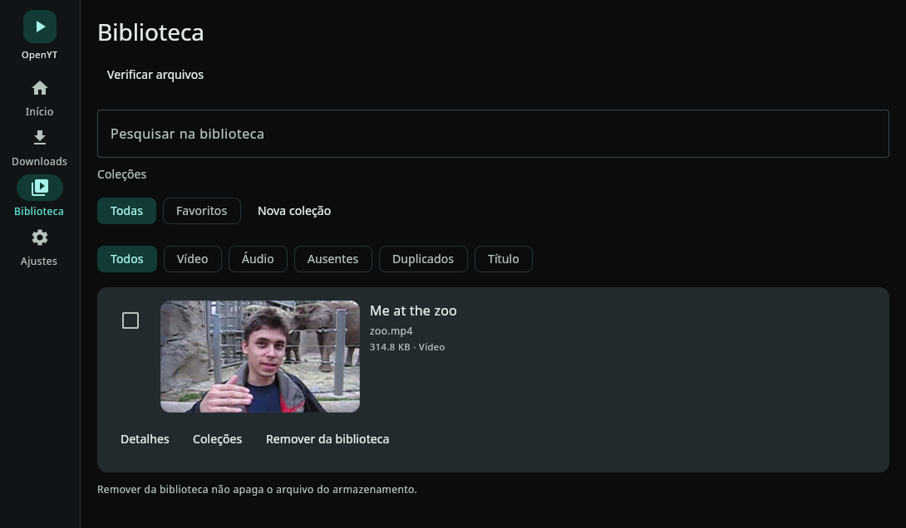
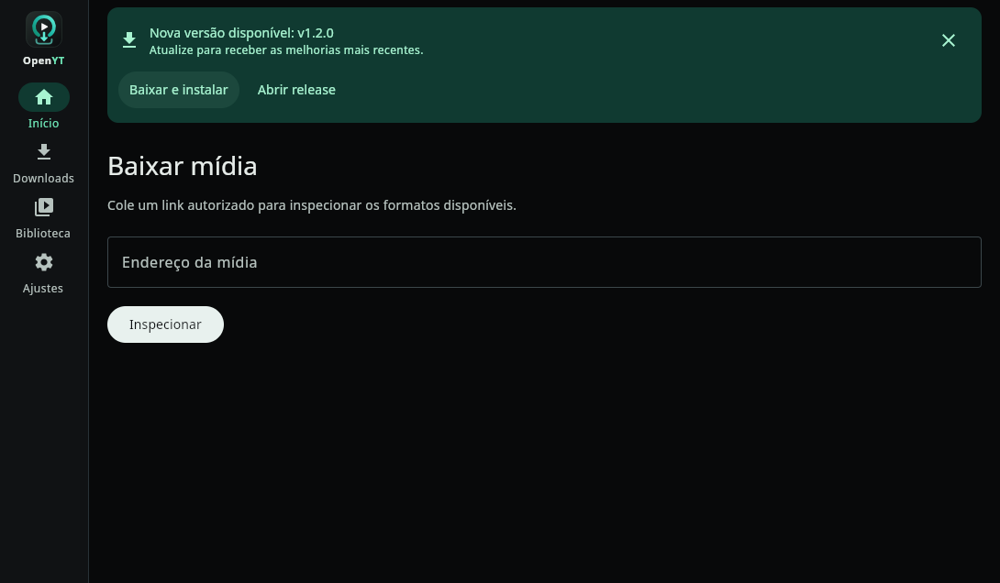

<picture>
  <source media="(prefers-color-scheme: dark)" srcset="docs/branding/openyt-lockup-dark.svg">
  
</picture>

Local-first, multiplatform media downloader and library manager built with Kotlin.

OpenYT lets a user paste or share a media URL, inspect available formats, download
authorized content, and organize it in a local library. There is no account and no
backend: the app runs entirely on the device.

> Status: Phases 0–3 validated on Linux and a real Android device. The queue and
> library persist locally; recovery marks interrupted downloads instead of
> auto-resuming them. Only features listed under "Current status" are implied.

## Screenshots

| Desktop library | Desktop update banner |
|-----------------|-----------------------|
|  |  |

## Download and install

Get the latest files from the [Releases page](https://github.com/AlexandreZanata/OpenYT/releases/latest)
(Android APK, Linux `.deb`, Windows `.msi`, macOS `.dmg`, checksums).

### Android

1. Download `androidApp-release.apk`.
2. Allow installing unknown apps for the browser or file manager.
3. Open the APK and install. Requires Android 8.0+ (`minSdk 26`); verified on arm64.

The Android build bundles yt-dlp and FFmpeg, so no extra setup is required.

### Linux

```bash
# Debian/Ubuntu (amd64)
wget https://github.com/AlexandreZanata/OpenYT/releases/latest/download/openyt_1.5.0_amd64.deb
sudo apt install ./openyt_1.5.0_amd64.deb
```

The release bundles yt-dlp, FFmpeg, FFprobe, and Deno. No extra setup is required.
Other distributions can install the package with their own `.deb` tooling.

### Windows

1. Download `OpenYT-1.5.0.msi`, run it, and confirm the SmartScreen prompt
   (More info → Run anyway) because the installer is unsigned.
2. Open OpenYT. yt-dlp, FFmpeg, FFprobe, and Deno are bundled.

The Windows package is built in CI but not yet validated on a real device.

### macOS

1. Download `OpenYT-1.5.0.dmg`, open it, and drag OpenYT to Applications.
2. The app is unsigned, so right-click → Open (or remove the quarantine flag):

```bash
xattr -dr com.apple.quarantine /Applications/OpenYT.app
```

yt-dlp, FFmpeg, FFprobe, and Deno are bundled. The macOS package is built in CI
but not yet validated on a real device.

## Download examples

Only download content you are authorized to obtain.

### Video (real example)

1. Paste `https://www.youtube.com/watch?v=jNQXAC9IVRw` (Me at the zoo).
2. Select **Inspect**.
3. Choose **Video** and pick a format, e.g. `240p · MP4 · 314.8 KB`.
4. Select **Download**; the file appears in **Downloads** and **Library**.

### Audio

1. Paste the same URL, or any authorized audio source.
2. Select **Inspect**, switch to **Audio**, and pick a format such as M4A or Opus.
3. Select **Download**.

### Playlists

1. Paste a playlist, channel, or album URL and select **Inspect**.
2. Choose **Video** or **Audio**, select the items (all are selected by default),
   and select **Download selected**.
3. Each item becomes its own queued download. Files are saved inside a folder named
   after the playlist, numbered in the original order (for example
   `My playlist/01 - First video [id].mp4`).

### Photos and images

Photo/image download is not supported yet. OpenYT downloads video and audio;
thumbnails are displayed in the app but are not saved as separate files.

## Supported sources and formats

OpenYT delegates extraction to yt-dlp, so any site supported by the installed
yt-dlp build can be inspected, including YouTube, Instagram, TikTok, X, Facebook,
SoundCloud, Vimeo, Twitch, Reddit, Pinterest, Dailymotion, Bandcamp, Threads,
Telegram, Bilibili, and Rumble. Branded icons identify these providers; other
sites use a generic icon. Site support depends on the bundled yt-dlp version and
on the source's terms and restrictions.

Playlists and channels use the same generic path. The app supports the video and
audio formats exposed by yt-dlp; image and subtitle downloads are not implemented.

## Stack

| Concern            | Choice                                                |
|--------------------|-------------------------------------------------------|
| Language           | Kotlin (product code)                                 |
| Shared logic       | Kotlin Multiplatform (`jvm`, `android`)               |
| UI                 | Compose Multiplatform (Android + desktop)             |
| Concurrency        | Kotlin Coroutines + `StateFlow`                       |
| Build              | Gradle Kotlin DSL + version catalog                   |
| Serialization      | kotlinx.serialization                                 |
| Extraction engine  | yt-dlp (external dependency; never reimplemented)     |
| Conversion         | FFmpeg (external dependency)                          |
| Distribution       | GitHub Actions                                        |

## Supported platforms

- Android (primary, `minSdk 26`) — verified on a real arm64 device during Phase 0.
- Linux desktop — verified during Phase 0.
- Windows/macOS — built in CI; not yet validated on real devices.

## Repository layout

```text
androidApp/     Android host application
desktopApp/     Desktop (Compose JVM) host application
core/           Pure Kotlin Multiplatform domain + application layer
engine-ytdlp/   Shared yt-dlp output/error/progress parsing
data/           SQLDelight database and repository implementations
ui/             Shared Compose Multiplatform UI and design system
docs/           Architecture, ADRs, planning, product, security, testing
```

`core` must never depend on Android SDK, Compose, yt-dlp, FFmpeg, or any I/O
framework. `ui` may depend on `core`, never the reverse. Host applications wire
platform implementations into the shared use cases.

## Build

Requirements:

- JDK 17+ (JDK 21 recommended)
- Android SDK with platform 36 and build-tools 36
- `ANDROID_HOME` or `local.properties` with `sdk.dir`
- Network access when packaging desktop builds (yt-dlp, FFmpeg, FFprobe, and Deno
  are downloaded and embedded)
- yt-dlp, FFmpeg, and Deno on `PATH` only when running the desktop app from source

```bash
./gradlew :core:allTests
./gradlew :androidApp:assembleDebug
./gradlew :desktopApp:run
./gradlew :desktopApp:createDistributable
./gradlew :desktopApp:packageDeb
```

Install the debug APK on a connected device:

```bash
./gradlew :androidApp:installDebug
```

## Validation

Unit and UI tests:

```bash
./gradlew :core:allTests :engine-ytdlp:allTests :data:desktopTest :desktopApp:test
```

Real Linux validation against the packaged `.deb` (extracts to an isolated
prefix, uses isolated `XDG_*` directories, downloads real media and checks files,
playlist layout, the database schema and a GUI screenshot):

```bash
./scripts/validate-linux.sh --scenario all
./scripts/validate-linux.sh --scenario all --no-build   # reuse an existing deb
./scripts/validate-linux.sh --scenario all --offline    # skip network scenarios
```

The packaged binary also exposes a headless CLI used by the validation script:

```bash
OpenYT --cli inspect  --url <url> --json
OpenYT --cli download --url <url> --kind video --dir <path> --json
OpenYT --cli playlist --url <url> --kind audio --limit 5 --json
OpenYT --cli library  --list --json
OpenYT --cli version
```

## Releases

Latest: [v1.5.0](https://github.com/AlexandreZanata/OpenYT/releases/tag/v1.5.0)
(Android APK, Linux deb, Windows MSI, macOS DMG, checksums).

Every push to `main` builds and publishes Android, Linux, Windows, and macOS
artifacts through `.github/workflows/release.yml`. The version lives in
`gradle.properties` (`openyt.version`). Android signing is optional; without
secrets the APK is debug-signed. See `docs/planning/RELEASE_PIPELINE.md`.

## Current status

- Paste or share a URL, inspect metadata/formats, choose video or audio, download
  with progress, cancel/retry, and manage a persistent local Library.
- Inspect playlists and channels, select items, and download them into a numbered
  playlist folder; provider icons identify common networks with a generic fallback.
- Priority-aware queue (high/normal/low), pause/resume with partial files preserved,
  automatic retries with backoff, and bulk resume of interrupted downloads.
- Queue and Library survive app restarts; interrupted downloads can be retried.
- Removing a Library entry never deletes the downloaded file.
- Library search, kind/availability/duplicate filters, title sorting, missing-file
  detection, safe duplicate cleanup, and technical detail dialogs.
- Thumbnails in the inspect result, Downloads, and Library on Android and desktop.
- Library collections: create, filter, and assign media; deleting a collection
  never touches files or library entries.
- Desktop uses larger responsive thumbnails and a themed wide layout.
- Shared OpenYT identity with light and dark themes, an adaptive Android launcher
  icon, and desktop window and package icons.
- Library details show technical metadata (duration, resolution, codecs, bitrate,
  container) via platform probes.
- Share completed media to WhatsApp, Drive, and any installed Android handler via
  the system chooser; open or reveal files on desktop.
- Import existing video/audio through the Android Storage Access Framework and
  export completed downloads to a chosen SAF tree.
- Redacted diagnostics (copyable) and an automatic GitHub update banner with
  assisted installer.
- Branded OpenYT launcher/installer icons; production-signed Android APK.
- Theme, language (pt-BR/en), and download concurrency are persisted locally.
- Desktop: sidebar layout, dropped-link intake, Ctrl+1…4/Ctrl+Q shortcuts, folder
  selection, multi-selection, and a Linux `.deb` package.
- Phase 0 viability report: `docs/planning/PHASE_0_VIABILITY.md`
- Project status and limitations: `docs/planning/STATUS.md`
- Architecture and module rules: `docs/architecture/OVERVIEW.md`
- Decisions: `docs/adr/`
- [Brand assets and usage guidelines](docs/branding/README.md)

## Licensing

OpenYT is distributed under GPL-3.0. This is required by the Android yt-dlp
wrapper (`io.github.junkfood02.youtubedl-android`, GPL-3.0). yt-dlp itself is
Unlicense; FFmpeg licensing depends on the build. See `THIRD_PARTY_NOTICES.md`.

OpenYT does not bypass DRM or access restrictions and must only be used to obtain
content the user is authorized to download, in accordance with the source's terms.
