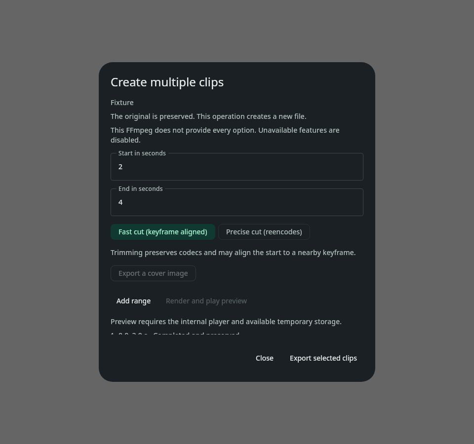

# Subscription rules and batch clips



[Capture provenance](assets/expansion-m4/README.md). Native verification is tracked
in the [validation ledger](testing/NEXT_EXPANSION_VALIDATION.md).

## Subscriptions

Open Settings → Local automation. Add a playlist or RSS/podcast feed, then choose
its interval, duration range, profile, per-check limit and pending limit. Leave an
optional limit blank to disable it. The first check records existing episodes as
baseline unless you explicitly choose to include them.

Preview decisions is read-only. The episode list explains queued, filtered and
deferred work. Unknown duration/size is deferred when a rule requires that metadata;
it is not guessed. A per-check cap preserves remaining candidates for later checks.
Inspection failures rotate through the backlog instead of starving later episodes.

Editing a filter does not automatically download historical rejected episodes.
Use Preview filtered history, choose Reevaluate, and confirm the download under
the current rules. Creating or renaming a profile updates the editor next time it
opens. Editing/deleting a profile never changes an already queued request snapshot.

Wi-Fi, unmetered and charging requirements are available where the platform can
confirm them. Desktop currently leaves these device-only options unavailable;
existing unsupported rules can be edited to remove the requirement. Requested
conditions are checked again before starting queued work. Loss of a condition
pauses active work; review it before resuming. A storage reserve is a best-effort
guard based on estimates; an unknown size waits rather than promising available space.

Foreground checks run while the application UI is open. Android also offers an
explicit background-check switch, off by default. Android may delay the minimum
15-minute checks. Background work discovers/persists episodes and exits; it does
not run an indefinite downloader or bypass force-stop. Review/start the queue in
the app. After a process restart, interrupted work requires explicit retry.

The desktop command below performs one bounded discovery pass, starts no downloads,
and installs no OS scheduler. A running GUI keeps exclusive ownership of checks.

```text
OpenYT --cli watch --discover-only
```

Automatic OS task registration is not advertised. See the
[optional capability gates](planning/NEXT_EXPANSION/OPTIONAL_GATES.md) for its scope.

## Batch clips

In the library, open an item's media tools and choose Create multiple clips.
Add start/end ranges, reorder them, choose output options and explicitly export.
The destination is the downloads folder shown in the editor; the queued recipe
keeps that choice even if global settings change later. Originals remain intact.

- **Fast cut:** preserves source codecs and may align to a nearby keyframe.
- **Precise cut:** reencodes using available H.264/AAC encoders.
- **Portrait fit:** preserves the full image, adding padding to 720x1280.
- **Center crop:** removes the sides; render a preview before choosing it.
- **Burn captions:** uses an imported/indexed, non-stale subtitle track with local
  media timings. Available only if the bundled FFmpeg includes subtitle rendering.
- **Cover:** selects a frame within the range; leaving the time blank uses its
  midpoint. The file is also copied into the durable artwork store.

Render and play preview uses the same recipe as export and requires the internal
player. An external-player fallback does not pretend to support that preview.
Unavailable encoders/filters remain disabled with an explanation.

Each clip has its own result. A failed later clip leaves earlier successes in the
library. Export again to retry unsuccessful selections without redoing completed
items. Cancel stops active/pending work and preserves completed clips. Restarted
jobs are shown as interrupted and require a deliberate retry. A verified output
and its library entry are published through a recoverable journal/transaction.

Portable backups preserve the output media and its normal library/assets/study
context. They do not restore machine-specific executable processing jobs or
OS scheduler registration. Detailed recipes remain local operation history.
