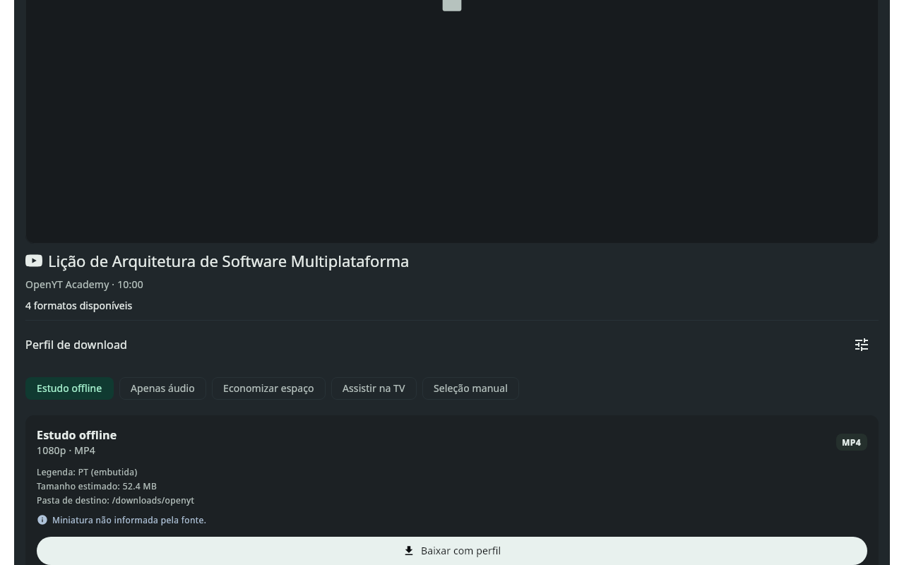
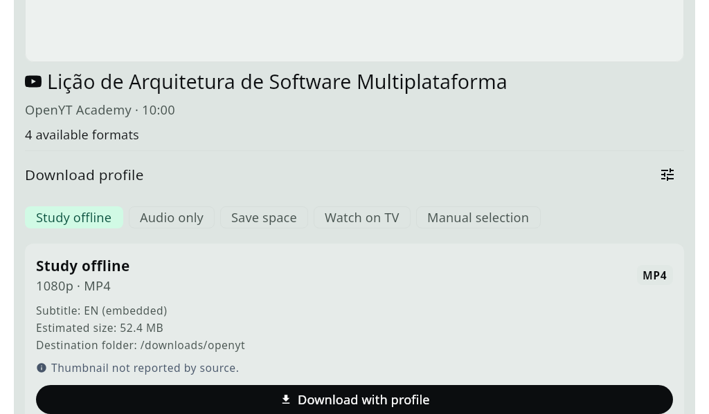
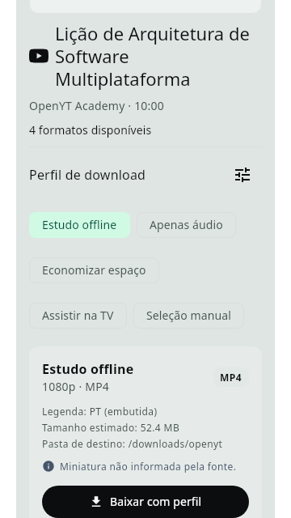
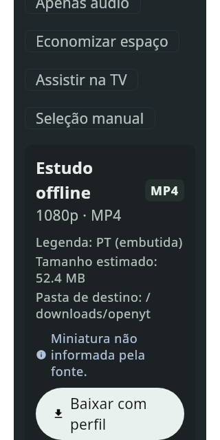

# OpenYT Download Profiles

Download Profiles introduce goal-oriented format resolution to OpenYT, allowing users to choose an understandable intent (*Study offline*, *Audio only*, *Save space*, *Watch on TV*, or custom profiles) rather than deciphering raw codec tags, container multiplexing, or manual stream combinations.

Profiles operate alongside existing manual format selection, snapshotting user decisions into immutable download requests.

---

## 1. Built-in Profiles

OpenYT ships with four immutable built-in profiles:

| Profile | ID | Media Kind | Target Container | Height Ceiling | Codec Preferences | Subtitle Handling | Intended Use Case |
|---|---|---|---|---|---|---|---|
| **Study offline** | `builtin-study` | Video | MP4 | 1080p | AVC (H.264) + AAC | Preferred language embedded (default: system locale) | Offline learning, courses, lectures with captions |
| **Audio only** | `builtin-audio` | Audio | M4A | — | AAC (M4A) | None | Music, podcasts, audiobooks, spoken word |
| **Save space** | `builtin-save-space` | Video | MP4 | 480p | AVC (H.264) + AAC | None (advisory size notice) | Metered connections, limited storage |
| **Watch on TV** | `builtin-tv` | Video | MP4 | 1080p | Strict AVC/H.264 + AAC | None | USB playback on smart TVs and legacy media consoles |

---

## 2. Deterministic Resolution Algorithm & Fallback Rules

Format selection uses a pure Kotlin Multiplatform resolver (`DownloadProfileResolver`):

1. **Media Kind Filtering**: Filters source formats matching the profile's requested kind (`VIDEO` vs `AUDIO`). If a video profile is evaluated against an audio-only source, resolution returns `ProfileResolution.Incompatible` with an actionable alternative (`SWITCH_TO_AUDIO`).
2. **Codec Ranking**:
   - For video: AVC/H.264 streams (`avc1.*`) are prioritized when `preferMp4Avc` or `tvCompatibilityStrict` is set; VP9/AV01 streams are selected as fallback if AVC is absent.
   - For audio: AAC (`mp4a.*`) is prioritized for MP4 containers; Opus/Vorbis are supported for WebM/MKV containers.
3. **Resolution Ceilings**:
   - The resolver filters out video streams exceeding `maxHeight` (e.g. 1080p for Study/TV, 480p for Save Space).
   - If no streams match at or below the ceiling, it gracefully falls back to the lowest available resolution and generates an explicit `ProfileWarning.FallbackResolution`.
4. **Subtitles Resolution**:
   - Matches tracks by primary language subtag (e.g., `pt`, `en`).
   - Prefers human-authored manual tracks over automatic captions (unless `allowAutomatic` is true).
   - If no matching subtitle is reported by the source, the download continues cleanly without corruption and generates a `ProfileWarning.MissingSubtitle`.
5. **Strict TV Compatibility**:
   - Enforces AVC video codec, AAC audio codec, and MP4 container. Sources lacking compatible codecs are rejected with `IncompatibilityReason.CODEC_UNSUPPORTED` and an actionable button switching to manual selection or alternate profiles.

---

## 3. UI Flow and Previews

### Interaction Rules
- **No Automatic Enqueue**: Switching profile chips updates the preview card only. Downloads strictly require clicking the explicit **"Download with profile"** (`Baixar com perfil`) button.
- **Actionable Alternatives**: When a profile is incompatible with a source, OpenYT renders the reason and a direct action button (e.g. *"Mudar para perfil de áudio"* or *"Escolher formato manualmente"*) instead of displaying dead or disabled buttons.
- **Session Preservation**: Selected profiles are preserved across tab navigation using `rememberSaveable`.

### Real Rendered Previews

Captured directly from Compose Desktop across varied screen widths, dark/light themes, and enlarged font scales:

#### Desktop (Dark Theme, Portuguese)


#### Desktop (Light Theme, English, 1.3x Font Scale)


#### Mobile Phone (Light Theme, Portuguese)


#### Mobile Phone (Dark Theme, Portuguese, 1.5x Font Scale)


---

## 4. Custom Profiles & Local Bindings

Users can create, edit, delete, and export custom profiles through the Profile Editor dialog (`ProfileEditorDialog`):

```json
{
  "schemaVersion": 1,
  "profile": {
    "id": "custom-1731410000000",
    "name": "Compact 720p",
    "isBuiltIn": false,
    "kind": "VIDEO",
    "maxHeight": 720,
    "preferMp4Avc": true,
    "audioPreset": "M4A",
    "subtitlePreference": {
      "type": "com.openyt.core.domain.ProfileSubtitlePreference.Preferred",
      "languagePrimaryTag": "pt",
      "allowAutomatic": false
    },
    "tvCompatibilityStrict": false,
    "estimatedSizeNotice": false
  }
}
```

### Local Destination Directory Bindings
- Stored separately in SQLite table `profile_destination_binding`.
- Never exported inside portable JSON profile definitions, preserving privacy across machines.
- Validated with `DestinationPermissionChecker` before execution.

---

## 5. SAF & Storage Isolation

- `destinationDirectory` is strictly a local filesystem path; Android `content://` URIs are rejected if passed as directory strings.
- Per-task `exportTargetUri` stores Android Storage Access Framework tree URIs independently.
- `SafExportRouter` performs copy-export after successful local tool download. If a SAF permission is revoked or fails, OpenYT records a warning without failing the intact local download.

---

## 6. Verification and Regression Suite

All profile capabilities are verified through deterministic unit, contract, and native integration tests:

| Contract | Description | Test Suite | Status |
|---|---|---|---|
| **`NX-P01`** | Built-in rules, deterministic fallback, subtitle resolution | `DownloadProfileResolverTest` (13 tests) | **VERIFIED** |
| **`NX-P02`** | Custom profile persistence, schema v19 migration, bindings | `DownloadProfileRepositoryTest` (8 tests) | **VERIFIED** |
| **`NX-P03`** | Immutable snapshots, SAF separation, restart & retry | `DownloadProfileSnapshotTest` (11 tests) | **VERIFIED** |
| **`NX-P04`** | Real output container confirmation, FFprobe stream validation | `DownloadProfileLocalTest`, `YtDlpDownloadOptionsTest` (16 tests) | **VERIFIED** |
| **`NX-P05`** | Accessible preview card, custom editor, UI across widths | `DownloadProfileUiTest` (20 parameterized tests) | **VERIFIED** |
| **`NX-P06`** | Combined native flow, SQLite restart/retry, manual coexistence | `DownloadProfileNativeFlowTest` (3 tests) | **VERIFIED** |
