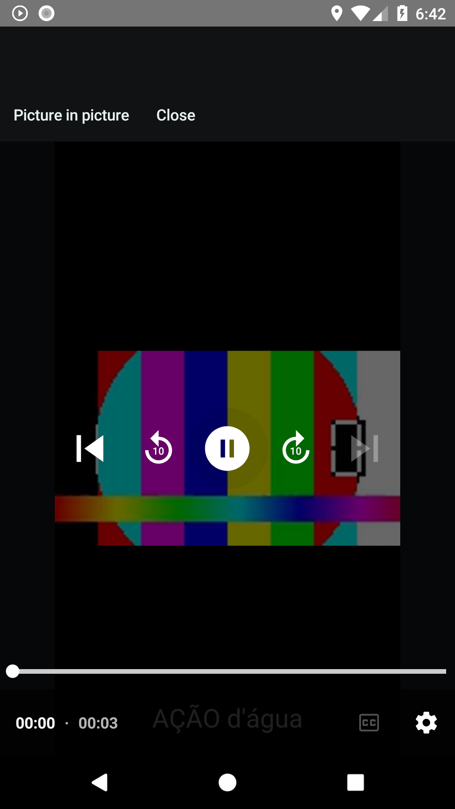
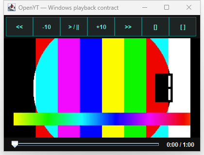

# Next expansion validation ledger

Date: 2026-11-14. Branch: `codex/complete-library-expansion`.
Delivery: [PR #64](https://github.com/AlexandreZanata/OpenYT/pull/64).
This records executed checks and their limits; it is not a physical-device
performance benchmark or a guarantee against every possible failure.

## Scope and recovered baseline

The interrupted handoff ended on PR #63 after M2/M3 had merged. Its existing
Windows shortcut/window probe failed before the new offline contract. The logs
and artifact were inspected; the failed-job retry of CI `43492611769` passed all
required environments. PR #63 merged as `f132e6ee8f1ba0681cee100109b819adde85830e`.

The delivery closes **52 mandatory NX0–NX8 tasks** and the two optional Android
background tasks NX7.7/NX7.8. NX7.9 automatic desktop scheduling and NX9.1 production
speech-runtime approval have explicit **NO_GO** decisions. NX9.2–NX9.6 are blocked
by that optional runtime gate, not implemented or advertised. See
[the tracker](../planning/NEXT_EXPANSION/PROGRESS.md) and
[capability decisions](../planning/NEXT_EXPANSION/OPTIONAL_GATES.md).

## Linux: combined regression and extracted DEB

Linux x86_64, JDK 21, Gradle 8.14.4, system libVLC, Xvfb and bundled
yt-dlp/FFmpeg/FFprobe executed:

```bash
env -u WAYLAND_DISPLAY -u XDG_SESSION_TYPE OPENYT_RUN_LOCAL_ENGINE_TESTS=1 OPENYT_RUN_MEDIA_TESTS=1 OPENYT_RUN_PLAYBACK_TESTS=1 OPENYT_FFMPEG="$PWD/desktopApp/build/bundled-tools/linux-x64/ffmpeg" OPENYT_FFPROBE="$PWD/desktopApp/build/bundled-tools/linux-x64/ffprobe" OPENYT_YTDLP="$PWD/desktopApp/build/bundled-tools/linux-x64/yt-dlp" xvfb-run -a ./gradlew :core:desktopTest :engine-ytdlp:desktopTest :data:desktopTest :media-ffmpeg:desktopTest :desktopApp:test :desktopApp:packageDeb --console=plain --max-workers=2
env -u WAYLAND_DISPLAY -u XDG_SESSION_TYPE xvfb-run -a scripts/validate-linux.sh --scenario all --no-build --offline
```

Both exited 0. The combined cancellation-adapter regression completed in 3m13s:
297 core, 29 engine, 130 data, 8 media and 129 desktop cases: **593 cases,
586 passed, 7 skipped, 0 failures/errors**. Skips are six opt-in desktop internet
cases and one separately opt-in incompressible ZIP64 budget case.
[JUnit summary](evidence/expansion-20261114/linux-results.json).

After the final clip feedback change, all three `ExpansionM4UiTest` cases and a
new DEB build passed again. The final packaged harness passed its local CLI/GUI,
cookies, library, archive, watch, storage, bulk operations, actual VLC and tool
scenarios, with four explicitly skipped internet scenarios. A restart-fixture
race was corrected by stopping/joining the old fake coordinator before opening
its successor; successful retry now also asserts the persisted library and
profile provenance. No product assertion was removed.

## Android: API 26 and API 36 native instrumentation

The full instrumentation command used isolated `.regression` application IDs:

```bash
ANDROID_SERIAL=<emulator> ./gradlew :androidApp:connectedDebugAndroidTest -Popenyt.testAbi=x86_64 -Popenyt.testApplicationIdSuffix=.regression -Pandroid.injected.androidTest.leaveApksInstalledAfterRun=true --console=plain --max-workers=2
```

API 26 (`OpenYT-NX-API 26-20261114`, Android 8.0) exited 0: **26 passed, 5 explicit
internet skips,0 failures/errors**. API 36 (`enterprise-f2-api36`, Android 16),
with `-Pandroid.testInstrumentationRunnerArguments.openyt.network=1`, exited 0:
**31 passed, 0 skipped, 0 failures/errors**, including all five actual internet
extraction cases. Numbers come from JUnit cases, not AGP progress notifications.
[Per-case evidence](evidence/expansion-20261114/android-results.json).

Coverage includes SQLite migration/reopen, profiles, offline assets, subtitle FTS,
study timestamps/A-B/export/deep links, SAF backup/restore, moved-file recovery,
PiP, actual packaged FFmpeg, all provider vectors and expanded D-pad/large-text UI.
All six clip capability flags were true on these emulators. The final focused
`AndroidClipContractsTest` passed again after strengthening it to prepare and
play **each of the three exported files** through the actual Media3 controller.
That focused repeat is listed separately and not added to the full-suite count.

Real WorkManager ran without a visible activity, fetched a loopback feed,
persisted an app-open-only queue and canceled its unique periodic job on opt-out.
Actual connection/power/free-space capability reads are exercised. Injected
condition transitions belong to deterministic execution-gate tests; physical
Wi-Fi/charging changes, exact scheduling and battery/thermal budgets are not
claimed. Background checks are opt-in, bounded and queue-only; force-stop is not
bypassed. No production app data was replaced and no physical phone test is claimed.

API 26 screenshot failures were traced to a virtual width exceeding the physical
framebuffer. The fixture now opens the activity before resizing, stays within
1000x1600 at 160dpi (asserting >=840dp), and waits for recreation/reset. D-pad,
icon and large-text assertions remain. A/B pause reads the actual main-thread
Media3 controller; its 250ms pause/1000ms loop tolerances remain. The study flow
captures the first native READY position and pauses for measurement, avoiding
both a missed seek observation and a false pass from natural playback crossing
the requested time. Its one-second accuracy assertion remains enabled.



## Windows 11 in the existing Docker VM

The existing `tbg-win11` VM built MSI+EXE and the contract harness using native
JDK 17/21, Gradle 8.14.4 and WiX in an isolated source checkout. Installed contracts
exercise both formats: actual desktop/Start-menu shortcuts, brand icon pixels,
real application frame, exact Unicode external handler and Explorer selection
(including a new MP4-only folder), three visible packaged VLC decode/mini-player
cycles, study/A-B/deep links, recovery and offline quotas. Only the registered
OpenYT test installation was replaced; application data and source media remained.

The installed `clips` contract exports three ranges, checks portrait/caption/cover
output, durable assets and SQLite receipt reopen, **plays all three files** with
packaged VLC, retries idempotently and verifies the original hash.
[MSI clip result](evidence/expansion-20261114/windows-msi-clips.txt),
[EXE clip result](evidence/expansion-20261114/windows-exe-clips.txt).

The final native build and all three shared Compose UI tests exited 0. The
same-artifact installed-contract rerun (`openyt-delivery-native-diagnose-20261114`)
exited 0 for both MSI and EXE, retaining the unchanged 90-second startup deadline.
Measured frame opening was 78.70 seconds (MSI) and 78.10 seconds (EXE).
[Native result summary](evidence/expansion-20261114/windows-results.json).

The [source/build fingerprint](evidence/expansion-20261114/native-source-fingerprint.json)
compares 243 Windows-target Kotlin/build inputs with the delivery archive. Android
sources and final test-fixture changes are validated separately. A fingerprint
is not a test pass; the installed harness exit/result is the execution evidence.
Robocopy retained evidence beyond PowerShell5's path-copy limit.



The loaded local VM previously required 66–87 seconds to expose its application
frame. One final attempt exceeded the unchanged 90-second limit: later state and
thread collection found the OpenYT frame responding with an idle event thread.
This failed attempt is retained as a startup/environment limitation, not silently
counted as a pass. On CI run 43649055829, the native installed shortcut contracts
measured 7.12 seconds for MSI and 3.32 seconds for EXE. Neither sample establishes a
universal startup budget; no physical Windows performance claim is made.

## Separate internet checks

Desktop `DesktopYtDlpEngineIntegrationTest`, explicitly enabled with
`OPENYT_RUN_NETWORK_TESTS=1` and bundled yt-dlp/FFmpeg/FFprobe/Deno, passed **6/6,
no skips** after the cancellation adapters changed: metadata, playlist,
output/progress, video merge, cancel and pause/resume.
[Per-case results](evidence/expansion-20261114/desktop-internet-results.json).
The fast public fixture can finish before pause observation; the test limits its
transfer to 1MB/s to prove an active partial pause, retained staging and resume.
The bundled engine binary and product behavior were unchanged by that fixture fix.

The final extracted DEB also ran public RSS discovery with isolated temporary
XDG state against `https://feeds.npr.org/510298/podcast.xml`. Add, discover-only
and list commands exited 0, initialized the 300-episode baseline and retained an
empty candidate queue. No episode media was downloaded; temporary state was
removed. API 36's five actual internet cases covered Archive.org/YouTube metadata,
video merge, M4A extraction, progress/cancel and temporary-file cleanup without
user credentials. Network skips elsewhere are never counted as successful downloads.

## Regression contracts and review corrections

Core/SQLite contracts prove legacy rule defaults, bounded history/backlog, fair
inspection, immutable profiles/constraints, preview without writes, explicit
replay and enqueue persistence before seen-set. Coordinator tests recheck queued
and active conditions, preserve manual-work fairness and pause on condition loss.

Real FFmpeg tests prove cancellation of an observed live process and reaping,
source hashes, portrait dimensions/codecs/duration, visible caption pixels, covers
and one-cover-budget retry, safe Arabic-locale caption formatting, anamorphic
SAR/DAR preservation, rotation before framing and the selected 3.5-second green
cover. SQLite tests prove schema 26 migration, interrupted jobs and atomic
library/receipt publication. Compose tests prove partial success/retry, retained
author, selected-batch success counts despite old receipts, and 320dp pt-BR/large
text layouts. Loading now reports preparation while capabilities are being read.

Bugbot identified and re-reviewed eleven corrected defects: constraint snapshots,
inspection fairness, replay confirmation, CLI adapter injection, profile refresh,
atomic clip publication, cover ownership/retry, author preservation, anamorphic
framing and ineffective bounded cancellation. The last fix uses cancelable OkHttp
RSS deadlines, interruptible desktop capture with bounded drains/process cleanup,
and per-inspection Android process IDs. `FeedCancellationTest`,
`InspectionCancellationTest` and `AndroidInspectionCancellationTest` observe
actual slow sockets/processes, cancellation and preservation of another download.
Android packaged Python cleanup and real WorkManager passed on both emulator APIs.

The final review found no remaining actionable defects in the reviewed changes.
[Contract mapping](../planning/NEXT_EXPANSION/CONTRACTS.md) and
[ADR-0026](../adr/0026-subscription-rules-and-clip-journals.md) define the behavior.
A crash can leave private preview cache files until later cleanup; automatic
complete cache reclamation is not promised.

## GitHub merge gate

[CI 43649055829](https://github.com/AlexandreZanata/OpenYT/actions/runs/43649055829)
passed all five required jobs at `cc79e85afe09c3cf52b7387dad2c35dbbcef542f`:
Linux build, Linux desktop, Windows installed MSI/EXE, macOS (including actual
FFmpeg rendering), and Android API 30 emulator. The opt-in external infrastructure
workflow is intentionally skipped on a PR. The final delivery head must pass the
same required checks before PR #64 is merged; current immutable results are exposed
in the [PR checks](https://github.com/AlexandreZanata/OpenYT/pull/64/checks).
No new release or version bump is part of this delivery.
