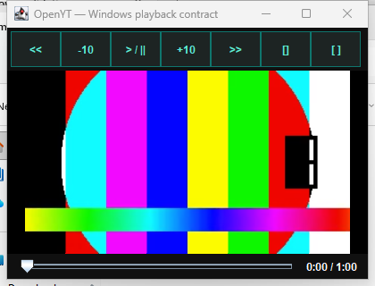
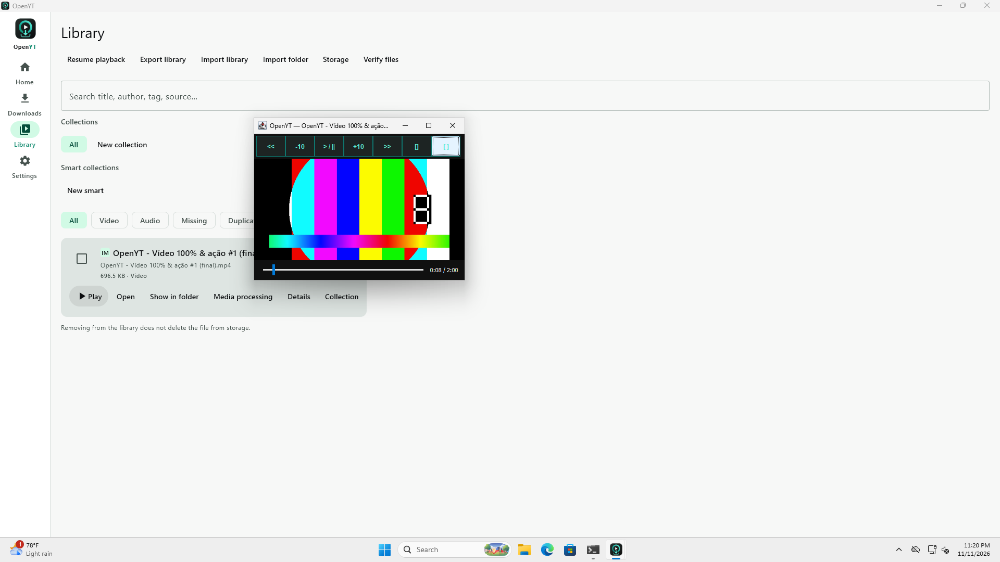
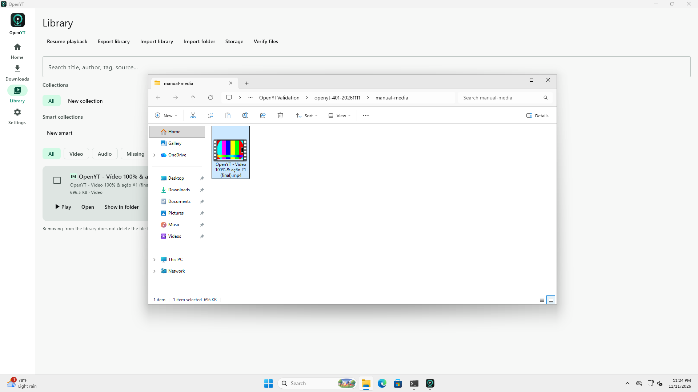

# OpenYT 4.0.1 validation

Updated: 2026-11-11.

This record covers the Windows playback, Explorer selection and installer fixes.
Published packages are listed on [Releases](https://github.com/AlexandreZanata/OpenYT/releases).
Implementation and requirements are in [ADR-0024](../adr/0024-windows-media-and-shortcuts.md)
and the [Windows desktop contracts](WINDOWS_DESKTOP_CONTRACTS.md).

## Native Windows validation

The existing local Windows 11 Pro x64 VM was started on the Linux host. Tests used
four virtual CPUs, 6 GiB RAM, Windows build 26200, Windows PowerShell 5.1, Temurin
21.0.13 for Gradle/jpackage and Temurin 17.0.21 for the Kotlin JVM toolchain.

The selection-fix installers and test harness were rebuilt on Windows from product commit
`97a9c6161f809075c975f96b12ad5c4fbb8ff199`. The source archive was checksum-verified
before extraction. The final run used the normal packaging configuration.

Both actual MSI and EXE from that validation snapshot passed:

- Installed version and source-catalog CLI checks.
- Desktop and Start-menu shortcut existence, launcher target, branded icon pixels
  and an application window opened through the actual desktop shortcut.
- External open reaching a temporary associated handler with the exact unchanged
  Unicode path, including spaces, accents, percent, ampersand and punctuation.
- Explorer selecting the requested file and a real MP4 on the first opening of a
  newly created folder containing only that video.
- Bundled libVLC 3.0.24 discovery, exclusion of conflicting external plugins,
  playback time advancement, visible decoded RGB test-pattern regions and a
  420-pixel always-on-top mini-player.
- MSI uninstall preserving the media fixture, followed by EXE installation and a
  complete repeat of the installed contracts.

[Native contract output](evidence/windows-4.0.1/installed-contracts.txt) and the
[validation receipt](evidence/windows-4.0.1/validation.json) retain the result,
source identity and local installer hashes. These hashes describe the tested local
builds; official packages have their own signed release manifest.



## Regression discovered by the real session

A new folder containing only an MP4 opened without retaining selection even when
SHOpenFolderAndSelectItems returned S_OK. Two fresh MP4 folders reproduced the
failure; TXT passed. Explicit parent/child PIDLs reproduced the same failure in
three further folders. A mixed folder containing test logs did not expose it.

The Kotlin adapter now waits for a loaded Explorer view, selects/focuses the file
through ShellFolderView.SelectItem when necessary, and requires three consecutive
observations of the actual selection. The corrected Kotlin implementation passed
both fresh MP4 cases and TXT through the installed runtime before repackaging.
The final MSI/EXE contracts then passed the fresh-video-folder regression.

The validation tools were also corrected:

- Decode the reference ICO's PNG entry directly; GDI+ Icon.ToBitmap corrupted its
  reference pixels despite the installed icon being correct.
- Retain process handles so short-lived CLI exit codes remain readable.
- Keep the temporary test JAR local to the alternate launcher instead of relying
  on an SMB/provider-qualified classpath.
- Capture the inherited Java VLC environment before native discovery clears it.
- Inspect the actual video canvas for substantial RGB pattern regions, rather
  than accepting arbitrary colored pixels from an overlapping Explorer window.

The first EXE packaging attempt reported WiX exit 103. Diagnostic and normal
repeats succeeded; both final installers were produced with the normal task
configuration. No release gate was removed to obtain a successful result.

## Manual interface checks

Library Play, reopening the video, switching to the mini-player, retaining it
above the main window, and Show in folder were exercised through the Windows
interface. Screenshots use generated media and a separate application profile.
The original profile was backed up inside the guest; no user media or database
was copied into the repository.





The VM remains running with OpenYT 4.0.1 installed. Temporary harness files are
removed from the installation. Local evidence does not claim testing every
Windows edition, GPU or third-party file-manager replacement.

## Deterministic and cross-platform checks

Eight file-action, external-fallback and Library/Downloads failure-message tests
passed locally after the selection fix, with zero skips, errors or failures.

The preceding 4.0.1 validation executed 205 deterministic tests successfully,
with 11 opt-in skips out of 216 discovered tests. Android debug assembly, an
isolated Linux DEB smoke run and real Linux VLC playback/mini-player/checkpoint
checks also passed. Four offline Linux scenarios requiring external networks
were deliberately skipped.

[CI 43122277215](https://github.com/AlexandreZanata/OpenYT/actions/runs/43122277215)
passed for the corrected product commit: Linux/Windows/macOS desktop checks,
unit tests and Android build, Android emulator instrumentation, native media
regressions and both installed Windows contracts. PR
[#46](https://github.com/AlexandreZanata/OpenYT/pull/46) integrated the fix into dev.

Earlier diagnostic and release-candidate runs failed at startup without jobs,
including [43097538295](https://github.com/AlexandreZanata/OpenYT/actions/runs/43097538295).
The successful PR run supersedes that earlier infrastructure blocker. Protected
branch checks and native release requirements remain enabled.

## Shutdown hardening after cross-platform CI

The first [PR #47 CI run](https://github.com/AlexandreZanata/OpenYT/actions/runs/43124444124)
passed the MSI contracts. The EXE logged successful decoded video and mini-player
checks, then failed to exit within 90 seconds. The earlier snapshot above remains
a completed local run, rather than proof that this shutdown race was impossible.

Playback cleanup was deferred to windowClosed, which can run after close returns
and overlap JVM/native-library shutdown. The component is now released
synchronously before its surface is disposed. Late callbacks from an old player
cannot affect a reopened one. This follows the VLCJ resource-cleanup lifecycle.

The corrected Kotlin code passed six independent Windows playback/process-exit
cycles through a temporary launcher using the installed JVM and native runtime.
Nine local tests also passed, including real Linux VLC playback, close/reopen,
checkpoint/resume and the eight deterministic action/UI checks.

Contract W06 now requires three complete playback/process-exit runs per installer.
Timeouts retain the failure and attempt a bounded thread dump. Final integration
and release checks are tracked on [PR #47](https://github.com/AlexandreZanata/OpenYT/pull/47).

## Release verification

The release workflow repeats native package checks before publication. Official
assets and their source commit are identified by the signed release manifest.
Verify a published 4.0.1 with:

```bash
python3 scripts/verify-release.py v4.0.1 --commit <release-main-sha>
```

Android and manifest signing use the configured release keys. Windows
Authenticode and macOS notarization availability remain explicit in
[the release policy](../adr/0022-verified-release-manifests.md).
